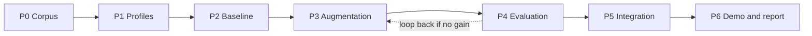
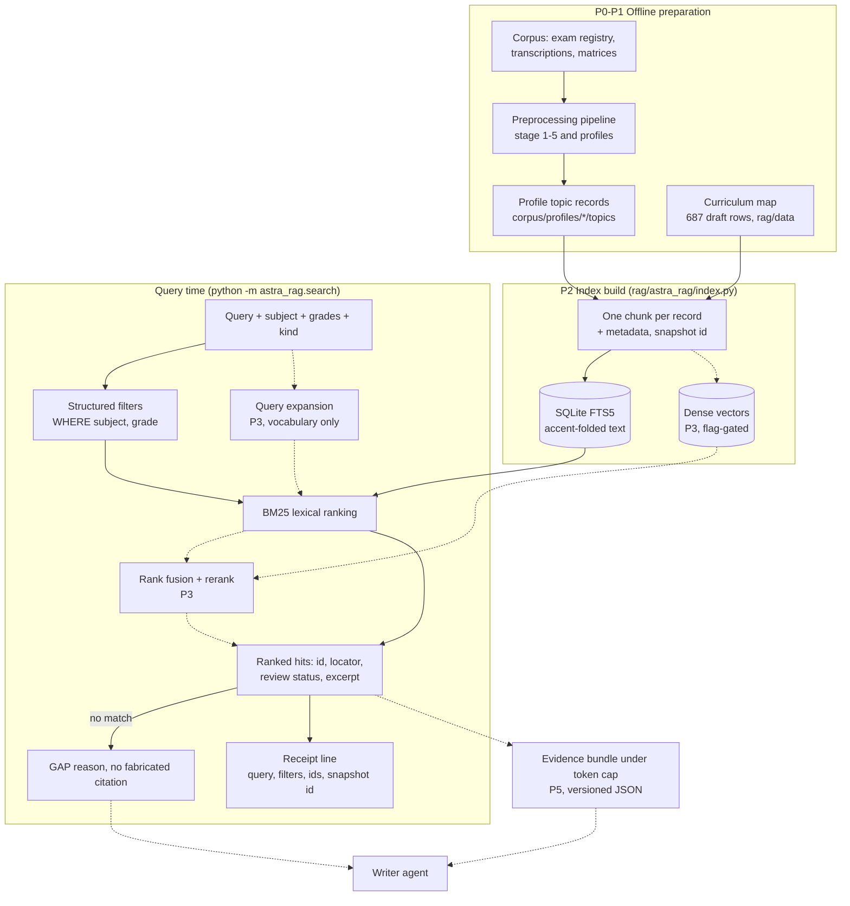

# Lab04 plan: phased build of the ASTRA exam-profile RAG

Status: **draft for Huy's review, 2026-11-06.** Spec: [spec.md](spec.md). Phases P0 and P1 describe work already in the repo; P2 has a runnable baseline; its screenshot gate remains open. P3 onward is not started. Each phase is one branch and one PR of about 300-400 changed lines (AGENTS.md Tier 2A), cut from the latest `origin/main`, with a short `tasks.md` list written at the start of that phase.

## RAG architecture (solid = built and run in P2, dashed = planned)

Reading it: filters run before ranking, so a wrong-grade or wrong-subject chunk can never be ranked. Profile hits carry the warning that their labels are agent-reviewed, not teacher-confirmed.

## Phase summary

| Phase | Goal | Exit gate (observed, not assumed) | State |
|---|---|---|---|
| P0 Prepare the corpus | Approved, registered source material | Registry, checksums, usable flags present | Done in repo |
| P1 Preprocess profiles | Retrievable per-subject records | Profiles parse; known gaps listed | Done, agent-reviewed only |
| P2 Baseline | Runnable lexical RAG with receipts | Command runs and prints ranked cited hits; tests run; screenshot | Implemented and run; screenshot pending |
| P3 Augmentation | Hybrid dense plus rerank, switchable | Each option runs; comparison table has real numbers | Not started |
| P4 Evaluate | Decide what to keep | Gold set, metrics, matched arms recorded | Not started |
| P5 Integrate | Retriever contract for Writer | Bundle JSON validated; leakage and gap tests pass | Not started |
| P6 Demo and Lab04 pack | Show it and submit | Screenshots, report, commit log, AI declaration | Not started |

## P0 Prepare the corpus (done)

What exists: 134-paper registry, transcriptions, matrix samples, manifests and checksums (`corpus/`), plus the RAG snapshot (`rag/`). Remaining work, small:

- Write one `corpus/SNAPSHOT.md` naming the snapshot id (git commit plus `SHA256SUMS.txt` hash) that every index and receipt will cite.
- Record the rule-8 exception (real-paper transcriptions in a private repo) as a proposed decision, since `docs/DECISIONS.md` is empty.

## P1 Preprocess the profiles (done, with limits)

What exists: stage 1-5 outputs and `corpus/profiles/<subject>/` records. Known limits to carry into every bundle: cognitive labels (NB/TH/VD) not teacher-confirmed; Toán has 9 unknown sources and Sinh 21 (`docs/corpus/PROFILE-UPDATE-2026-11-06.md`); other subjects still changing.

Remaining work: a `chunker` spec only, no new data. One chunk = one topic record (`topics/<id>.json`), with the markdown file as display text, parent = the subject `PROFILE.md` section. Fields per FR1. Needs the owner to say whether `.json` or `.md` is canonical for text (open question, section 8 of the spec).

## P2 Baseline: lexical RAG you can run

Implemented: offline SQLite FTS5 indexing of curriculum and profile JSON records with structured filters, deterministic ranking, gaps, and local receipts. The verbatim snapshot remains unchanged; adapters live under `rag/compat`. See [how-to-query.md](how-to-query.md) for observed CLI output and [p2-run-log.md](p2-run-log.md) for test results and integration skips.

Gate: CLI output observed and tests run and reported; **screenshot not captured**, so the full written gate remains open. No P3 work has started.

## P3 Augmentation (switchable, each must earn its place)

Order of trial, cheapest first. Keep a change only if P4 shows a gain on held-out queries.

| Option | Pick | Why |
|---|---|---|
| Query expansion | Synonym and unaccented-variant list from the curriculum map; **expands vocabulary only, never filters** | Matches plan section 6 |
| Dense retrieval | Compare `multilingual-e5-small` (small) with BGE-M3 (about 2.27 GB per the architecture plan) | Laptop cost matters; measure Vietnamese quality, startup, size |
| Fusion | Reciprocal rank fusion of FTS5 and dense lists | Simple, no training |
| Rerank | Coverage re-rank already in `assistant_curriculum_source.py`; optional cross-encoder only if dense plus RRF is not enough | Measured option, not an obligation |
| Parent expansion | After ranking, attach the parent `PROFILE.md` section; recheck filters after expansion | Prevents later-topic leakage |
| Diversity | Drop near-duplicate chunks; require one hit per requested topic | Coverage over repetition |

Gate: each option runs behind a flag in the CLI; no option is on by default until P4.

## P4 Evaluate (real runs only)

1. Gold set `rag/tests/gold_profile_queries.json`: start from the 30 existing questions, add unaccented text, synonyms, formulas, wrong-chapter labels, later-topic distractors, no-answer, cross-subject traps. Hold out a fixed share that no tuning touches.
2. Metrics: source recall@k, MRR, out-of-scope rate, gap correctness, latency, index size, token cost of the bundle.
3. Arms: no retrieval, lexical, lexical plus expansion, hybrid, hybrid plus parent expansion.
4. Matched generation test: same blueprint through the Writer in each arm; blind teacher or member review. If the backend cannot run (the Toán lab stopped because the dev CLI rejects images), say "not run" and do not report a conclusion.
5. Write results to `rag/docs/lab04/results.md` with the command and date for every number.

Gate: a table of recorded numbers. Loop back to P3 if nothing beats the baseline.

## P5 Integrate with the MAS

- Freeze the bundle contract as versioned JSON (`rag/schema/evidence_bundle.v1.json`): items, locators, review status, gaps, receipt id.
- Add leakage tests: wrong subject or grade never appears; profile text is treated as data.
- Plain function call from the orchestrator (the MVP default, Problem 7); stub caller if the real Writer is not ready.
- Append decisions to `docs/DECISIONS.md` only after the team agrees: retrieval stack (Problem 10), snapshot id, rule-8 exception.

## P6 Demo and Lab04 submission

- Streamlit page: request box, filters, ranked evidence with locators, gaps in red, receipt download. (Handout links the Streamlit tutorial; Streamlit is an extra dependency, so say so in the PR.)
- Screenshots of the feature running, and of tests and CLI output.
- Development report in the lab repo `25125083_W04/Exercise01/report.md`, built to HTML and PDF with `tools/build_report.py`: spec, plan, phases, what each AI session did, what Huy changed and checked, real numbers, limits. Mermaid diagrams: use case, ER, sequence of one request.
- `25125083_W04/README.md` with AI Usage Notes, `Git Commit Log.md`, zip `25125083_W04_01.zip` through `tools/pack.py`.
- Log each AI session with `tools/agent-log.sh` and in the README.

## Proposed decisions (not yet agreed, not yet in DECISIONS.md)

| Proposal | Reason |
|---|---|
| Baseline is FTS5 lexical; dense is optional and flag-gated | Cheap, inspectable, measured before heavier parts |
| Chunk unit is one profile topic record, parent is the profile section | Keeps meaning intact |
| Structured filters decide scope; embeddings never do | Stops later-topic leakage |
| Snapshot id on every receipt | Reproducible runs |
| Demo slice is Toán first | Most complete profile (143 topic files) |

## Risks

- P2 ran, but the snapshot's own tests only pass through adapters: 57 pass and 6 are skipped because original product paths and the pipeline module are absent (see `p2-run-log.md`). The adapters are not evidence that the product integration works.
- Profiles change while Sol is still writing; pin a snapshot and re-sync deliberately.
- Profile labels are agent-reviewed; the demo must say so on screen.
- A dense model may be too large for a teacher laptop; the baseline must stay useful without it.
- Scope creep: one feature, one subject slice, until P4 says otherwise.
