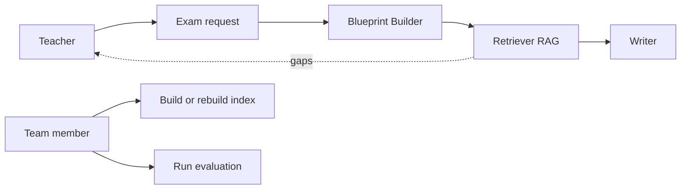
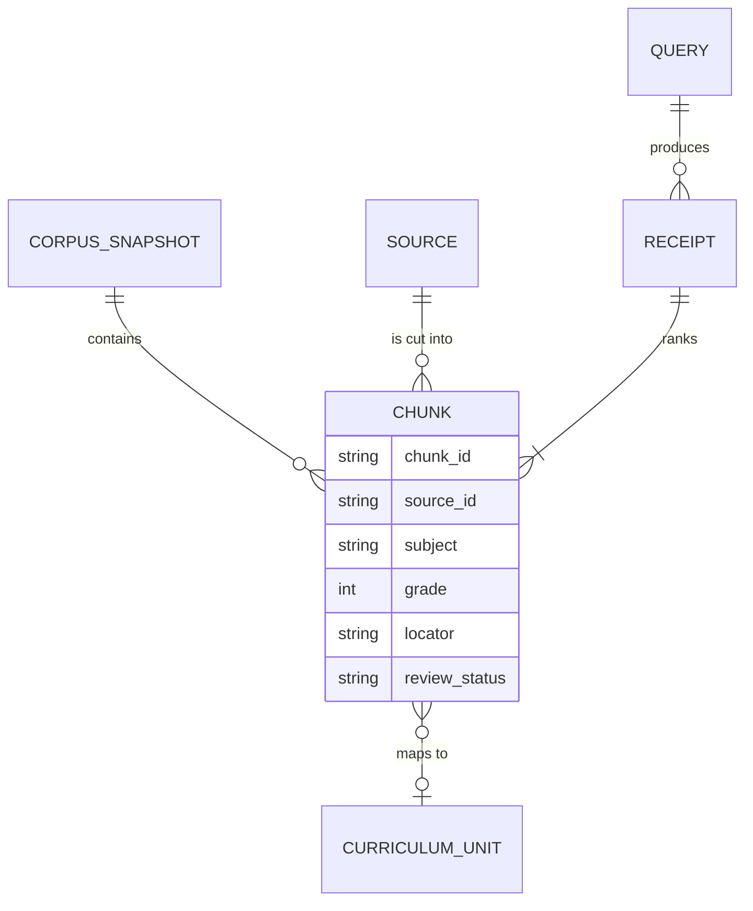

# Lab04 spec: ASTRA exam-profile RAG (the one feature)

Status: **draft for Huy's review, 2026-11-06.** Nothing here has been built or run. Targets are hypotheses until a recorded run says otherwise (AGENTS.md rule 9).

Method follows the Lab04 handout: write the spec first, then a plan, then tasks, then implement in phases (Spec Kit style). The handout asks for one feature, shown in action, with a development report, Git commit log and AI usage declaration. Companion file: [plan.md](plan.md).

## 1. The feature in one sentence

Given a subject, grade range and a teacher-style request (for example "Toán 12, hàm số, câu vận dụng"), the RAG returns a **bounded, cited evidence bundle** made of (a) curriculum-map units and (b) exam-profile topic records, which the Writer agent uses to draft items inside the blueprint. It reports a **gap** instead of inventing evidence.

This is the Retriever box of the MVP plan ([../../../docs/mvp-plan.md](../../../docs/mvp-plan.md), section 5, milestone M3).

## 2. Why this feature, and what we already have

| Input | Where | State (from the repo, not from a run) |
|---|---|---|
| Corpus: exam registry (134 papers), transcriptions, matrix samples | `corpus/` | Uploaded; PDFs not in repo; private-repo exception recorded in `docs/corpus/SUMMARY.md` |
| Preprocessing: stage 1-5 pipeline outputs, per-subject profiles (`corpus/profiles/<subject>/`) | `corpus/audit/`, `corpus/profiles/` | Toán 143 topic files, five subjects updated 2026-11-06; **agent-reviewed, not teacher-accepted** |
| Curriculum map: 687 draft rows, grades 10-12 | `rag/data/*.jsonl` | Draft; CHECKS/GAPS notes list known holes |
| Lexical retriever, evidence bundle (3000-token cap), coverage re-rank | `rag/src/` | Compiles; **tests never run here**; imports two product modules that are not copied |
| 30-question assistant eval | `rag/tests/assistant_eval_curriculum.json` | Exists; not run |

## 3. Users and stories

| Who | Story | Done when |
|---|---|---|
| Blueprint Builder / Writer agent | As the Writer, I get cited evidence per item spec so I stay inside the confirmed scope. | Bundle has ids, locators, grade, level hints, gaps |
| Teacher (via UI) | As a teacher, I see which sources backed each question and what was missing. | Demo shows evidence list and gap messages |
| Team member | As a reviewer, I can re-run retrieval offline and get the same ids. | One command, pinned corpus snapshot hash |
| Course TA (Lab04) | I can see the feature running and read how it was built. | Screenshots, report, commit log, AI declaration |

## 4. Requirements

**Functional**

- FR1 Index two record kinds: curriculum units (`rag/data`) and profile topic records (`corpus/profiles/*/topics/*.json|md`). Each chunk keeps `source_id`, subject, grade, locator, language, review status, and a corpus snapshot id.
- FR2 Query = free text + structured filter (subject, grade set, optional chapter limit). Filters are applied as structured conditions, never by embedding similarity (architecture plan section 6).
- FR3 Vietnamese handling: accent-folded and accented matching, formula/symbol tokens kept.
- FR4 Baseline retriever is lexical (SQLite FTS5 or the existing BM25-style code). Augmentation adds dense retrieval, rank fusion and rerank, each switchable.
- FR5 Output is a typed bundle under a token cap: items with id, text excerpt, locator, score, review status; plus `gaps[]`. Evidence is data, never instructions to the model.
- FR6 No match means a gap entry. No fabricated citation, no silent widening to other subjects or grades.
- FR7 Every retrieval writes a receipt (query, filters, ranked ids, snapshot id, retriever version).

**Non-functional**

- NFR1 Runs on a laptop with no GPU and no paid API for the baseline. Dense model size and latency are measured before adoption.
- NFR2 Deterministic: same query and snapshot give the same ranking.
- NFR3 Rights: no textbook text, no keys, no original PDFs in the index; only the approved corpus above (AGENTS.md rule 8).
- NFR4 Honest limits: profile cognitive labels are unconfirmed by teachers and the bundle says so.

## 5. Out of scope for Lab04

Teacher progress overlay and private tenants; reference-item (full question) retrieval with keys; GraphRAG; fine-tuning; hosted vector service; learner data; textbook ingestion.

## 6. Success criteria (all to be **measured**, none assumed)

| Criterion | How measured | Pass line (hypothesis, to be agreed) |
|---|---|---|
| Source recall@5 on a gold set | `rag/tests` gold queries written from the 30-question eval plus new ones | Baseline number recorded first; augmentation must beat it on held-out queries |
| Out-of-scope rate (wrong grade/subject in top 5) | Same set | 0 for structured filters |
| Gap handling | No-answer queries return a gap | 100% of no-answer cases |
| Latency and index size | Timed run on the owner's laptop | Reported, no fixed line until the baseline exists |
| End-to-end value | Same blueprint with no retrieval, lexical, hybrid; compared by blind review | Reported; RAG is kept only if it helps |

## 7. Diagrams (Mermaid, handout section 1)

Use case:

Data model:

## 8. Open questions for Huy (decide before Phase 2)

1. Which subject is the Lab04 demo slice: Toán (most complete) or Toán plus Hóa?
2. Is the Writer agent's real code available to integrate with, or does the demo use a stub caller?
3. Confirm the demo UI: Streamlit (the handout links a Streamlit tutorial) or CLI only.
4. Confirm the proposed `D-nnn` decisions in the plan before they are appended to `docs/DECISIONS.md`.
